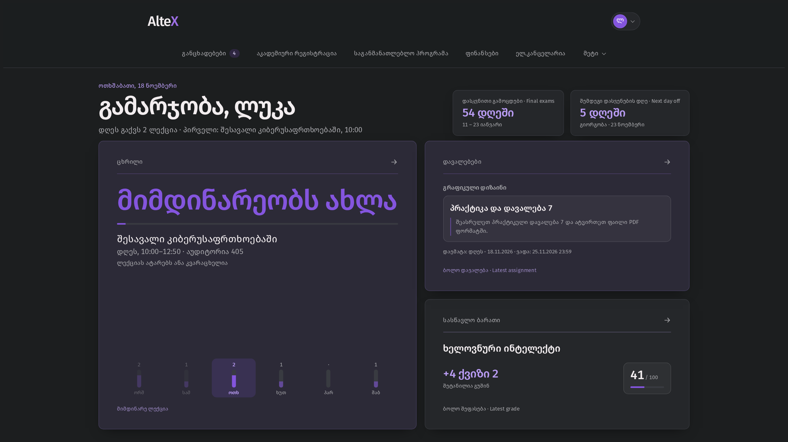
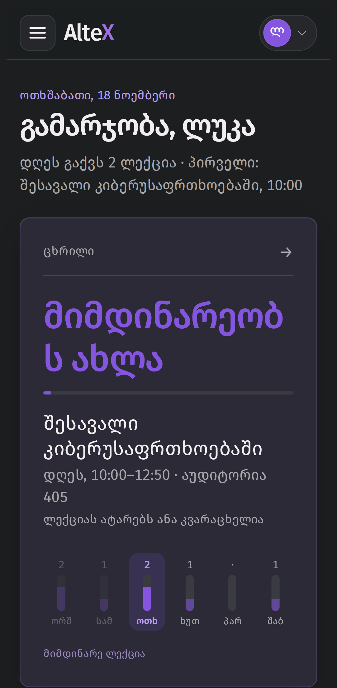
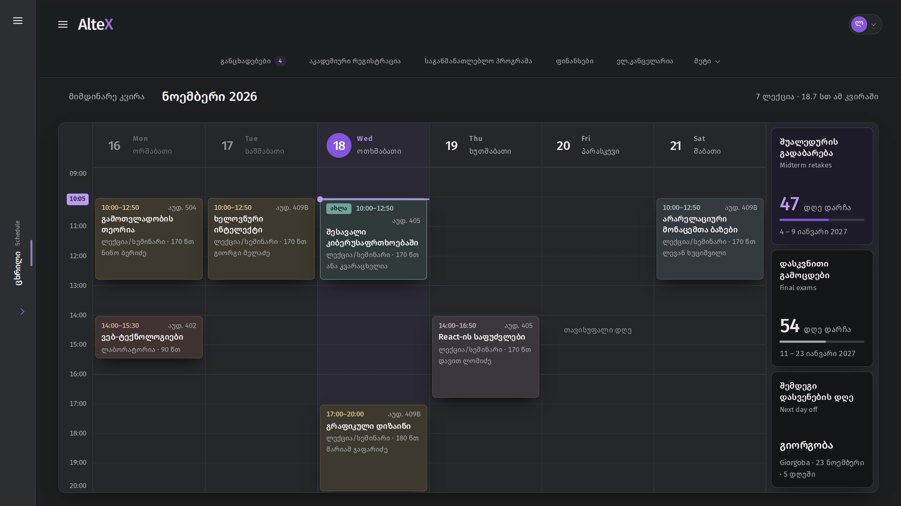
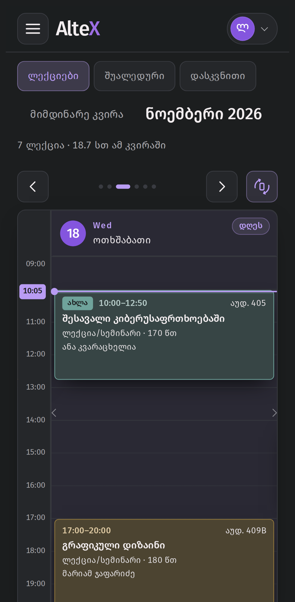

# AlteX — Student Portal

A redesign of the Alte University student portal (`students.alte.edu.ge`): clearer, easier to use, and about **7× faster** when switching between sections.

**[Install on PC](#installation-on-pc)** · **[Install on Android](#installation-on-android)**

## Speed

AlteX remembers each section's data, so going back to a section is almost instant:

- **Instant repeat visits:** sections you opened in the last 5 minutes show their data from memory, then refresh quietly in the background.
- **Loads ahead:** pointing at a link starts fetching that section before you click.
- **No duplicate requests:** switching back and forth quickly asks the server only once.
- **Never stale after a change:** any save or logout clears the memory straight away.

On average a section's data is ready in **0.14 s instead of 0.95 s**. The first visit to a section still waits for the portal's server.

## Problem

The Alte University student portal works, but it is far from user-friendly. Its outdated design, cluttered layout, confusing navigation and unnecessary clicks make even simple tasks frustrating. Important information is hard to find, the timetable is hard to read, and many parts of the interface lack the clarity students need.

Students shouldn't have to fight the portal just to keep up with university life.

## Screenshots: PC & Android

Made-up student and made-up data, not a real account.

### Dashboard

Next lecture with a live countdown, the latest assignment, the latest grade, and days until exams.

  
  

### Timetable

The week as a time grid: today highlighted, the running lecture marked, a line at the current time. The exam countdowns take Sunday's column when it has no lessons.

  
  

### Learning card

GPA, credits and the average at a glance; every subject with its score bar and pass mark, and what is still needed to pass.

  
  

### Login

  
  

## What it does

Idea is simple.
- Restyles the portal with its own stylesheets (`css/`).
- Adapts the portal's pages with content scripts (`js/`). It only reads: nothing is ever submitted for you.

## Installation on PC

AlteX is on the Chrome Web Store:

**[AlteX on the Chrome Web Store](https://chromewebstore.google.com/detail/gjbaoejelhdhbfcegfkommmgpogffloo?utm_source=item-share-cb)**

## Installation on Android

**[Download AlteX for Android (APK)](https://github.com/nikol1313/AlteX/releases/latest/download/AlteX.apk)**

1. Open the link above on your phone; it always downloads the newest version.
2. Open the downloaded `AlteX.apk`. The first time, Android asks to allow installs from your browser: allow it.
3. Tap **Install**, open AlteX and log in.

Newer versions install over the old one and keep you logged in.

`android/` wraps the portal in an Android WebView and injects this same extension code, so phones get the redesign and live data too. It is built from `manifest.json` (no separate copy of the code) and released as an APK on GitHub Releases. See [`android/README.md`](android/README.md).
