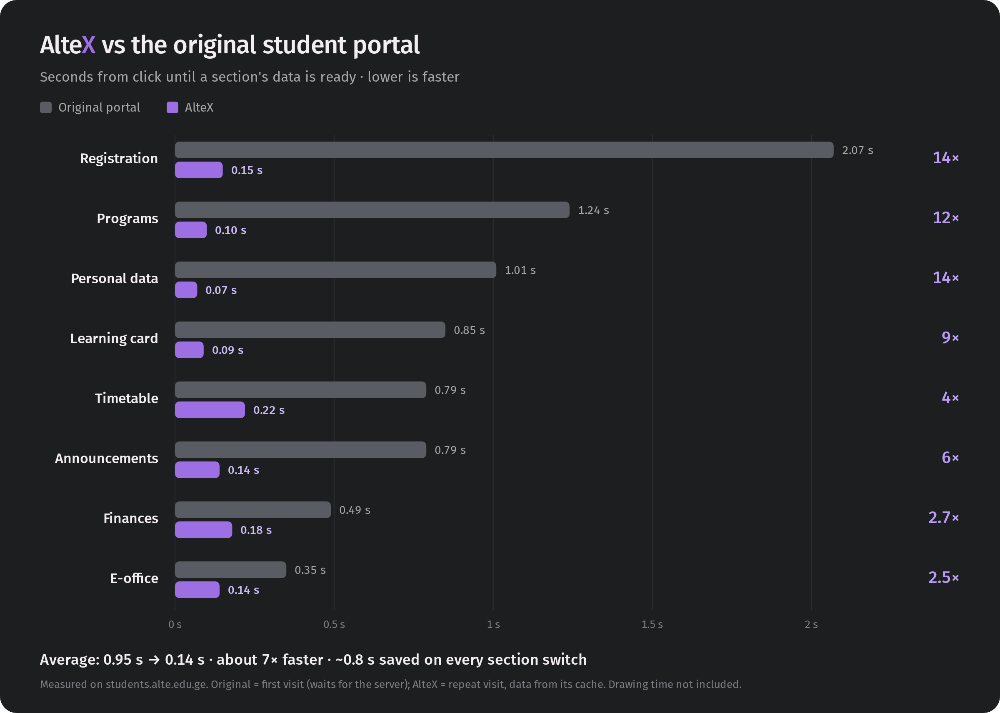
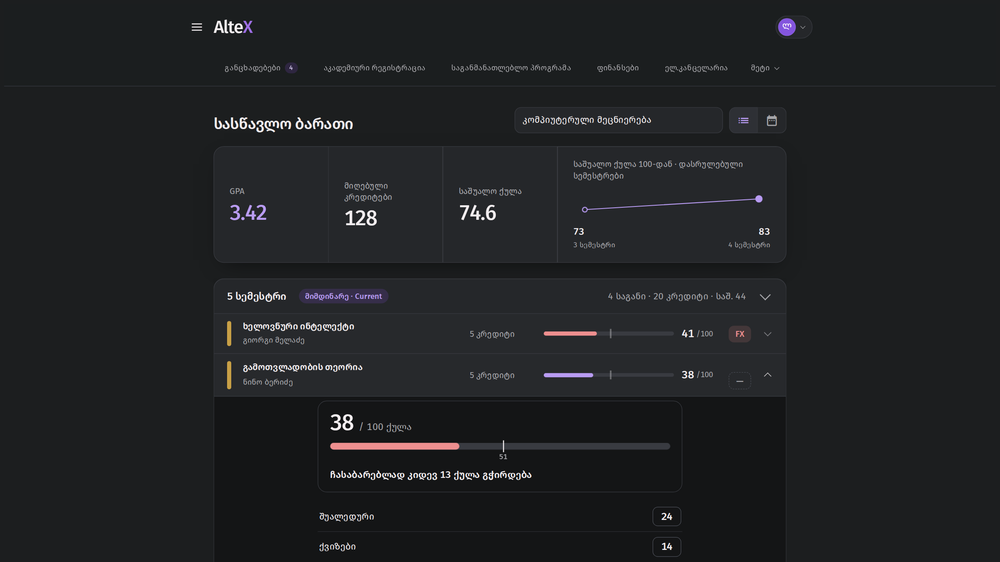
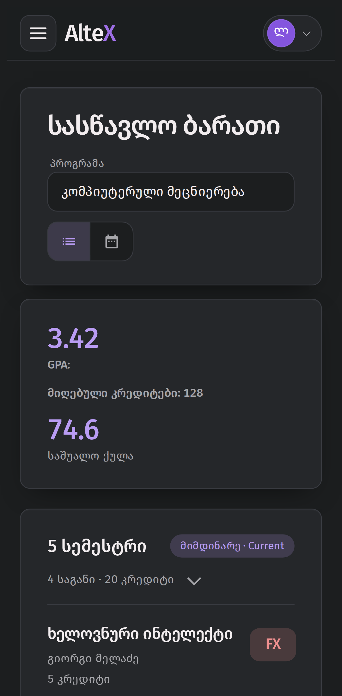
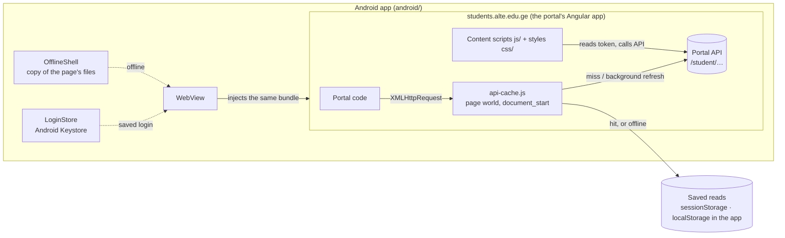

# AlteX — Student Portal

A redesign of the Alte University student portal (`students.alte.edu.ge`): clearer, easier to use, about **7× faster** when switching between sections, and it works **offline** in the Android app.

One codebase ships two ways: a Chrome extension (Manifest V3) and an Android app that injects the same code into a WebView.

**[Install on PC](#installation-on-pc)** · **[Install on Android](#installation-on-android)** · **[How it works](#how-it-works)**

## Speed

AlteX remembers each section's data, so going back to a section is almost instant:

- **Instant repeat visits:** sections you opened in the last 5 minutes show their data from memory, then refresh quietly in the background.
- **Loads ahead:** pointing at a link starts fetching that section before you click.
- **No duplicate requests:** switching back and forth quickly asks the server only once.
- **Never stale after a change:** any save or logout clears the memory straight away.

On average a section's data is ready in **0.14 s instead of 0.95 s**. The first visit to a section still waits for the portal's server.

**How it was measured:** the time from opening a section until its data is on screen, on the real portal, with and without AlteX, averaged over the portal's sections. <!-- TODO before pushing: how many runs, which sections, which device/network -->

## Offline (Android)

No connection? The app still opens and shows the last data you saw:

- **The portal's page is kept on the phone.** The portal sends everything with `Cache-Control: no-store`, so the WebView keeps nothing by itself. The app saves its own copy of the page's public files (HTML, scripts, styles), fetched without your cookies, and serves that copy when the phone is offline.
- **Everything is saved when you log in.** A few seconds after logging in, the app quietly opens every section (timetable, learning card, assignments, finances, programs and more) in a hidden frame, so all of it is ready offline, not only the sections you visited. Messages and announcements are left out, because opening them can mark them as read.
- **Your data is kept for up to 7 days.** The same cache that makes sections fast is saved on the phone in the app. While offline it answers with the last copy however old it is, including when the phone still thinks it is online but requests fail.
- **An "Offline" notice shows** while the connection is gone, and the page reloads by itself when it comes back (unless you have typed something that a reload would lose).
- **Logging out deletes the saved data.** A change tried while offline never reaches the server, so the saved data stays correct.

## Problem

The Alte University student portal works, but it is far from user-friendly. Its outdated design, cluttered layout, confusing navigation and unnecessary clicks make even simple tasks frustrating. Important information is hard to find, the timetable is hard to read, and many parts of the interface lack the clarity students need.

Students shouldn't have to fight the portal just to keep up with university life.

## Screenshots: PC & Android

Made-up student and made-up data, not a real account.

### Dashboard

Next lecture with a live countdown, the latest assignment, the latest grade, and days until exams.

  
  

### Timetable

The week as a time grid: today highlighted, the running lecture marked, a line at the current time. The exam countdowns take Sunday's column when it has no lessons.

  
  

### Learning card

GPA, credits and the average at a glance; every subject with its score bar and pass mark, and what is still needed to pass.

  
  

### Login

  
  

## How it works

AlteX does not replace the portal. It runs inside it and changes how it looks and how it loads:

- **Styles** (`css/`) restyle every section; **content scripts** (`js/`) rebuild the dashboard, timetable and learning card from the portal's own API. They only read: nothing is ever submitted for you.
- **`js/api-cache.js`** runs in the page's own JavaScript world, before the portal starts, and wraps `XMLHttpRequest`. That is the only place the portal's Angular requests can be seen. Reads are cached (stale-while-revalidate), identical requests in flight are merged, links are fetched ahead on hover, and any write clears the cache. If anything fails it falls back to the portal's normal request.
- **One source of code, two platforms.** The Android build (`android/app/build.gradle.kts`) reads `manifest.json` and bundles the same CSS and JS into one script, which the WebView injects at document start. There is no second copy to keep in sync.
- **Android-only parts** are native: saved login encrypted with the Android Keystore (`LoginStore`), file downloads (`Downloads`), update checks against GitHub Releases (`UpdateCheck`), and the offline copy of the page (`OfflineShell`).
- **Privacy:** nothing leaves the device except the portal's own traffic (and, in the app, an update check against GitHub Releases at most every 6 hours). There is no server, analytics or tracking.

## Tests and releases

- **165 Playwright end-to-end tests** run on every push, on a desktop and a phone viewport. They load AlteX into fake portal pages with made-up data, so CI never touches the real portal or a real account (`tests/e2e/`).
- **Android releases are automated:** pushing a tag `android-vX.Y.Z` builds a signed APK in GitHub Actions and publishes it to GitHub Releases. The app checks for it and offers the update.
- **Screenshots** in this README are generated by `scripts/screenshots.js` from made-up data.

## Installation on PC

AlteX is on the Chrome Web Store:

**[AlteX on the Chrome Web Store](https://chromewebstore.google.com/detail/gjbaoejelhdhbfcegfkommmgpogffloo?utm_source=item-share-cb)**

## Installation on Android

**[Download AlteX for Android (APK)](https://github.com/nikol1313/AlteX/releases/latest/download/AlteX.apk)**

1. Open the link above on your phone; it always downloads the newest version.
2. Open the downloaded `AlteX.apk`. The first time, Android asks to allow installs from your browser: allow it.
3. Tap **Install**, open AlteX and log in.

Newer versions install over the old one and keep you logged in.

`android/` wraps the portal in an Android WebView and injects this same extension code, so phones get the redesign and live data too. It is built from `manifest.json` (no separate copy of the code) and released as an APK on GitHub Releases. See [`android/README.md`](android/README.md).
