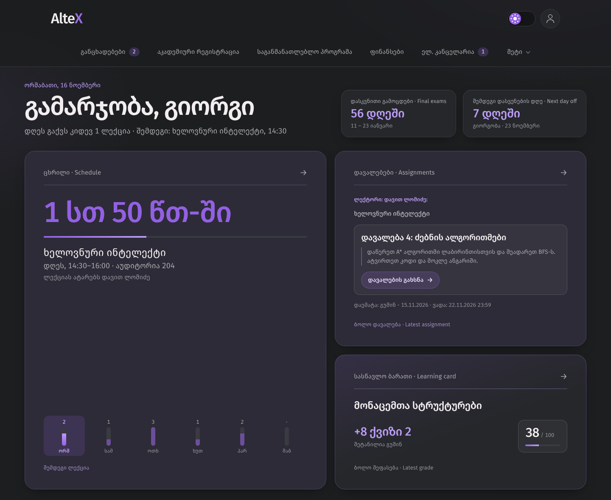
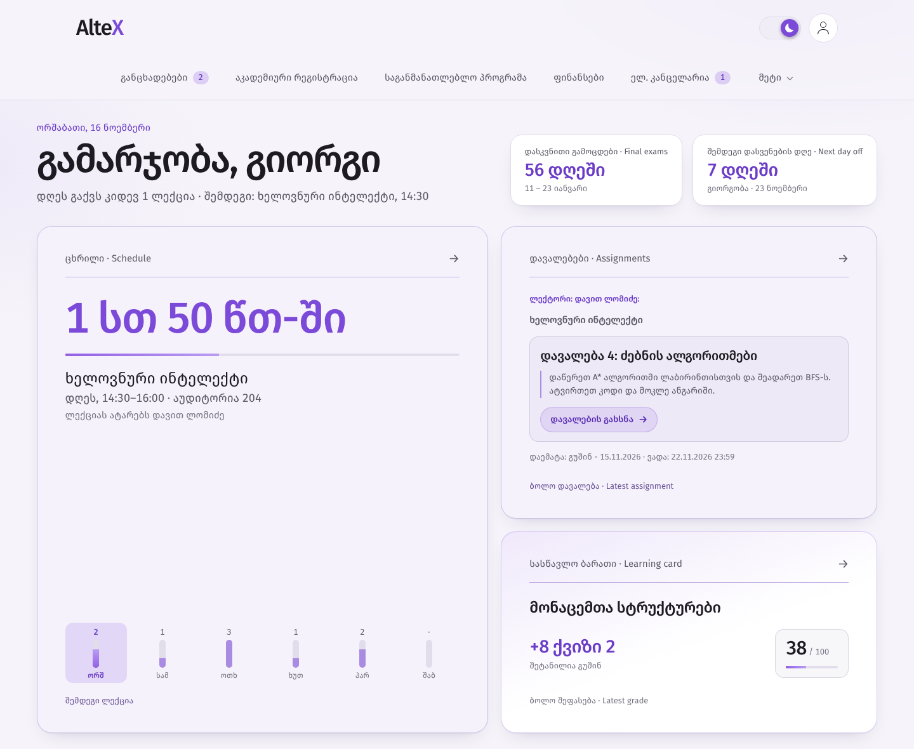
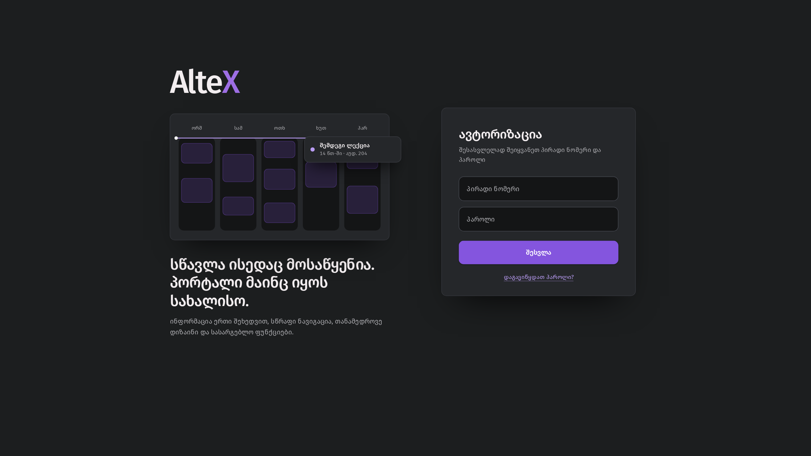
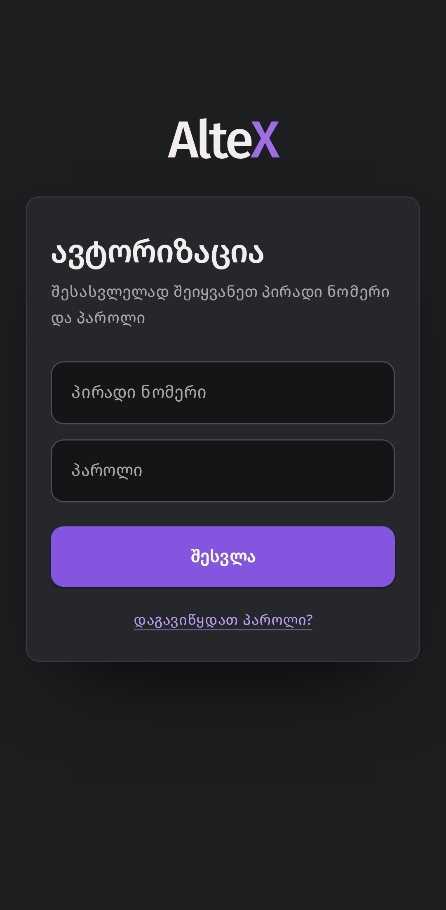

# AlteX — Student Portal Chrome Extension

Visual redesign of the Alte University student portal (`students.alte.edu.ge`).

## Demos PC & Android

Screenshots use a made-up student and made-up data, not a real account.

### Dashboard

Next lecture with a countdown, the latest assignment, the latest grade, and days until exams.

  
  

### Timetable

One card per day, today highlighted, the running lecture marked, and exam countdowns on top.

  
  

### Login

  
  

To retake them after a design change: `npm run screenshots` (see `scripts/demo/`).

## Problem
The Alte University student portal is functional, but the experience is far from user-friendly. Its outdated design, cluttered layout, confusing navigation, and unnecessary clicks make even simple tasks frustrating. Important information is harder to find than it should be, the timetable is difficult to read, and several interface elements lack the clarity students need.

Students shouldn't have to fight the portal just to keep up with university life.

## What it does

- Injects stylesheets (`css/`) that restyle the portal UI.
- Runs content scripts (`js/`) that adapt page behavior and markup (read-only: nothing is submitted for you).

## Installation for PC

The extension is published on chrome web store

**[AlteX-Chrome-Extension](https://chromewebstore.google.com/detail/gjbaoejelhdhbfcegfkommmgpogffloo?utm_source=item-share-cb)**

## installation on Android

**[Download AlteX for Android (APK)](https://github.com/nikol1313/AlteX/releases/latest/download/AlteX.apk)**

1. Open the link above on your phone; it always downloads the newest version.
2. Open the downloaded `AlteX.apk`. The first time, Android asks to allow installs from your browser: allow it.
3. Tap **Install**, open AlteX and log in. Tick "დამახსოვრება ამ ტელეფონზე" to stay logged in.

Newer versions install over the old one and keep you logged in.

`android/` wraps the portal in an Android WebView and injects this same extension code, so phones get the
redesign and live data too. It is built from `manifest.json` (no separate copy of the code) and released as an
APK on GitHub Releases. See [`android/README.md`](android/README.md).
